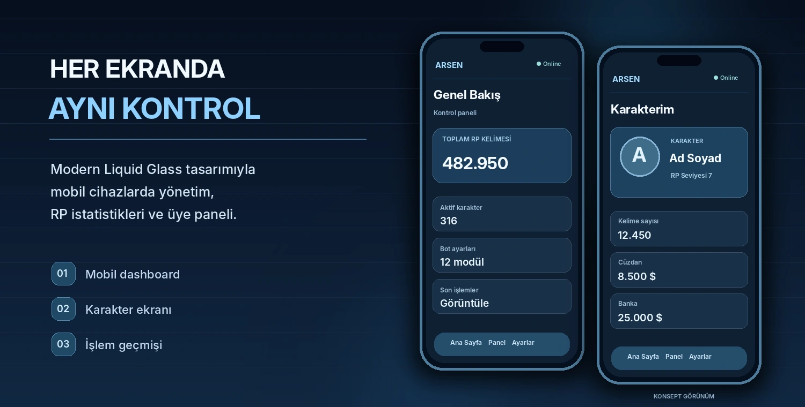
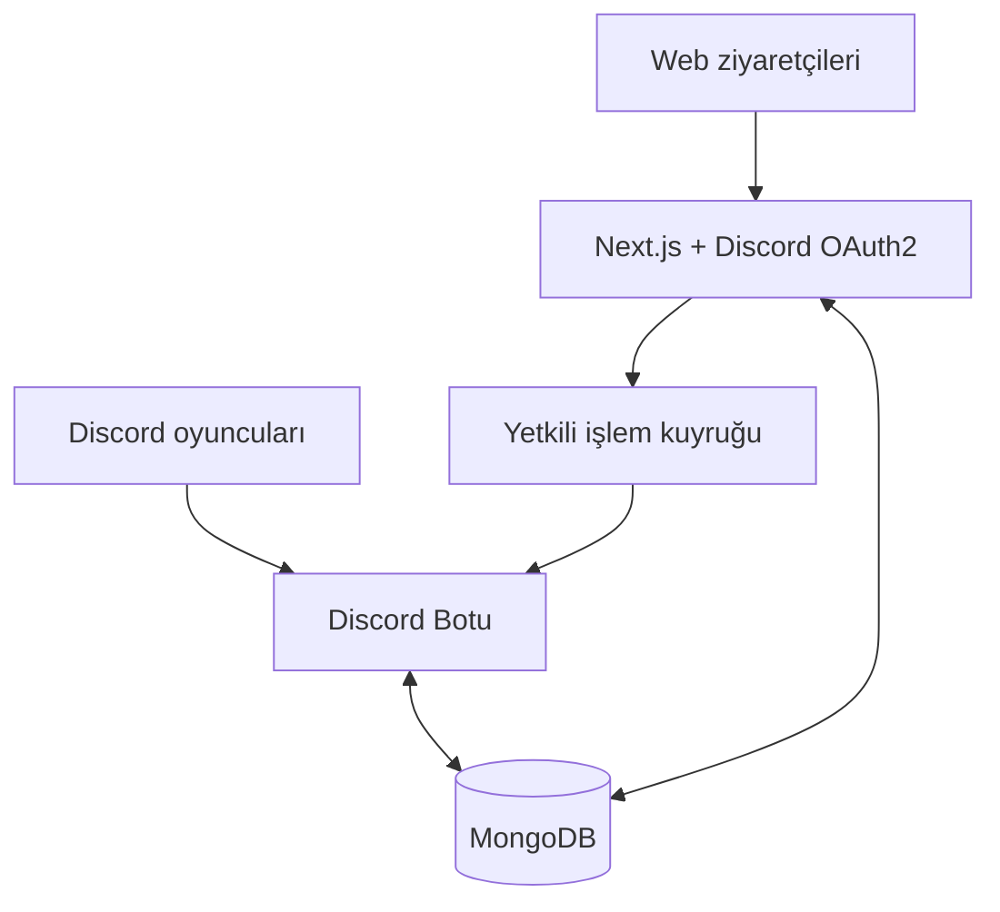

 

# ArseN Development

### WEB PANELLİ GELİŞMİŞ ROLEPLAY BOTU

**Bir Discord botundan fazlası. Sunucunuzu yönetin, evreninizi yaşatın, topluluğunuzu tek bir ekranda buluşturun.**

Discord botu · Web yönetim paneli · Karakter portalı · Roleplay ekonomisi

 

 

**Aylık kullanım: 800 TL** &nbsp; | &nbsp; **Tek seferlik satın alma: 5.000 TL**

[**Özellikleri keşfet**](#-neler-sunuyor) &nbsp;·&nbsp; [**Web panelini incele**](#-web-yönetim-paneli) &nbsp;·&nbsp; [**Paket ve fiyatlar**](#-paketler-ve-fiyatlandırma) &nbsp;·&nbsp; [**Satın alma**](#-satın-alma-ve-iletişim)

---

## ✦ Roleplay dünyanızın yönetimi artık tek yerde

Bir roleplay sunucusunu canlı tutmak yalnızca komut çalıştırmaktan ibaret değil. Karakter kayıtlarının düzenli olması, RP etkinliğinin takip edilmesi, ekonomik dengenin korunması ve yetkililerin aynı sistem üzerinden çalışması gerekiyor.

**ArseN Development Roleplay Altyapısı**, bu ihtiyaçları birbirinden kopuk botlarla değil, birlikte çalışan **Discord botu + web paneli + MongoDB** yapısıyla karşılamak için geliştiriliyor.

<table>
  <tr>
    <td width="33%" valign="top">
      <h3>◈ Discord Botu</h3>
      Slash komutlar, Components V2 paneller, kayıt, RP, moderasyon, ekonomi, Guard ve log sistemleri.
    </td>
    <td width="33%" valign="top">
      <h3>◇ Yönetim Paneli</h3>
      Discord ile giriş, rol ve kanal yapılandırması, sunucu ayarları, yetkili işlemleri ve kayıt geçmişi.
    </td>
    <td width="33%" valign="top">
      <h3>✧ Karakter Portalı</h3>
      Oyuncuya özel karakter kimliği, RP ilerlemesi, sıralamalar, envanter ve ekonomi görünümü.
    </td>
  </tr>
</table>

> **Bir sunucuya özel kurulum:** Bu paket mevcut haliyle tek bir Discord sunucusuna göre yapılandırılır. Sunucunun adı, teması, renkleri, rolleri ve kullanılacak modüller ihtiyaca göre uyarlanabilir.

---

## ◈ Web yönetim paneli

Görsel, ürünün tasarım yönünü göstermek amacıyla hazırlanmış bir arayüz konseptidir. Sayılar örnektir; canlı sunucudan alınmamıştır.

### Yönetim için Discord'da komut aramak zorunda kalmayın

Botun desteklediği yönetim işlemlerini modern, sade ve yetkiye göre özelleşen bir web ekranından takip edin. **Discord OAuth2** ile giriş yapan kullanıcının erişim alanı kontrol edilir; hassas değişiklikler yetkili işlem akışı üzerinden gerçekleştirilir.

| Yönetim alanı | Neler yapabilirsiniz? |
| :--- | :--- |
| **Genel Bakış** | Sunucu ve bot durumu, topluluk istatistikleri, kayıtlı karakterler ve etkinlik verileri |
| **Üye Yönetimi** | Kullanıcı kayıtlarını, karakter bilgilerini ve ilgili RP/ekonomi verilerini görüntüleme |
| **Roleplay Yönetimi** | RP kategori seçimi, kelime takibi, seviye hedefleri, ödül ve sıralama ayarları |
| **Ekonomi** | Cüzdan/banka verileri, yetkili bakiye işlemleri, market ve ekonomi kayıtları |
| **Bot Kurulumu** | Kanal–rol eşlemeleri, ilgili sistem ayarları ve desteklenen kurulum işlemleri |
| **Moderasyon & Guard** | Yetki sınırları, güvenlik kontrolleri, koruma modülleri ve log inceleme |
| **Site İşlem Geçmişi** | Giriş–çıkış ve yönetim işlemlerinin denetlenebilir kayıtları |

**Tek kaynak, tutarlı veri:** Discord botu ile web paneli, ilgili MongoDB kayıtlarını ortak kullanır. Yetki gerektiren işlemler için bot tarafındaki doğrulamaların korunması hedeflenir.

---

## ◇ Mobil kullanım için de tasarlandı

Mobil görünüm konsepti; gerçek ekran görüntüsü değildir.

Web paneli yalnızca masaüstü bilgisayarda kullanılmak üzere düşünülmedi. Telefon ve tabletlerde de hızlı erişim sunan **Liquid Glass** tasarım yaklaşımı kullanıldı.

- **Mobil gezinme:** Ana sayfa, üye paneli ve yönetim ekranlarına kısa yoldan ulaşım.
- **Uyarlanabilir düzen:** Dar ekranlarda tek sütunlu formlar, okunabilir tablolar ve dokunmaya uygun kontroller.
- **Kişisel üye ekranı:** Karakter bilgileri, seviye, RP istatistikleri ve ekonomi verileri.
- **Tutarlı görsel kimlik:** Gece laciverti, petrol mavisi, saydam yüzeyler ve yumuşak geçişler.

---

## ✧ Neler sunuyor?

### 01 — Karakter ve kayıt sistemleri

Karakterlerin yalnızca Discord rollerinden ibaret kalmadığı, sunucu evrenine ait kişisel verilerinin de takip edildiği bir deneyim.

- Üye kayıt, rol seçimi ve kayıt geçmişi.
- Karakter kimliği, profil görseli ve ek kimlik alanları.
- Web üzerinden karakter bilgilerinin görüntülenmesi.
- Sunucuya özel karşılama, kayıt ve rol arayüzleri.

### 02 — Roleplay sayımı ve ilerleme

RP etkinliğini ölçülebilir hale getirin; hangi alanlarda oyun oynandığını ve topluluğun nasıl geliştiğini görün.

- Yönetici tarafından seçilen **RP kategorilerinde kelime sayımı**.
- Kullanıcı bazında toplam kelime ve istatistik takibi.
- **RP seviye sistemi**, ödül rolleri ve isteğe bağlı ekonomi ödülleri.
- RP sıralamaları ve web üzerinden kişisel ilerleme ekranı.

### 03 — Gelişmiş ekonomi

Rol yapma deneyimini sunucu içindeki ekonomik düzenle destekleyin. Maaşlar sunucunun meslek rollerine göre belirlenebilir; ödeme düzeni ve tutarlar sunucunun ekonomik dengesine uyarlanır.

- Cüzdan, banka, para transferi ve işlem kayıtları.
- Market ve envanter altyapısı.
- Yetkili bakiye işlemleri ve ekonomi logları.
- Rol bazlı **haftalık maaş dağıtımı**.

### 04 — Moderasyon ve güvenlik

Topluluğunuz büyüdüğünde yönetim yükünü kontrol altında tutmaya yardımcı araçlar.

- Ban, unban, kick, mute, jail ve uyarı işlemleri.
- Mesaj, isim, rol ve ilgili üye yönetimi araçları.
- **Guard:** Yetkisiz kanal/rol değişikliklerine, riskli işlemlere ve toplu saldırı örüntülerine karşı koruma modülleri.
- Whitelist, işlem sınırları ve olay kayıtları.

### 05 — Log ve işlem denetimi

Bir işlem gerçekleştiğinde kimin, neyi, ne zaman yaptığını geriye dönük takip etmek için ayrı kayıt alanları.

- Üye, moderasyon, mesaj, kanal, ses ve sunucu logları.
- RP, ekonomi, Guard ve komut kayıtları.
- Konsol loglarının uygun Discord kanalına aktarımı.
- Web oturumları ve yönetim işlemleri için **site logları**.
- Discord üzerinde botun görünümüyle uyumlu **Components V2 Container** mesajları.

### 06 — Günlük topluluk araçları

AFK, avatar/banner, davet, mesaj–ses istatistikleri, sıralamalar, çekiliş ve yardımcı Discord komutları tek bot çatısında bulunabilir. Modüller kurulum kapsamına göre yapılandırılır.

---

## 💰 Rol bazlı maaş yönetimi

Roleplay ekonomisinin önemli parçalarından biri olan meslek maaşları, **rol bazlı haftalık maaş mantığıyla** çalışır. Her meslek rolü için bir tutar belirlenebilir; dağıtım sırasında aynı üyeye ait ücretler topluca hesaplanır.

### Maaş nasıl hesaplanır?

**Bir üye birden fazla maaşlı Discord rolüne sahipse rollerinin ücretleri toplanır ve üye başına tek ödeme yapılır.**

| Örnek rol | Örnek haftalık tutar |
| :--- | ---: |
| Şerif | 1.000 $ |
| FBI Ajanı | 800 $ |
| Doktor | 750 $ |
| Öğretmen | 700 $ |
| Hemşire | 600 $ |
| Garson | 500 $ |

**Örnek:** Doktor ve Öğretmen rollerine sahip bir üyenin haftalık maaşı **750 $ + 700 $ = 1.450 $** olur. Yukarıdaki tutarlar tanıtım amaçlıdır; müşterinin sunucusuna göre belirlenir.

<table>
<tr>
<td width="50%" valign="top">

<b>Bot tarafında mevcut</b>
<ul>
<li>Maaşlı Discord rollerini tanımlama</li>
<li>Haftalık otomatik dağıtım</li>
<li>Gerektiğinde yetkili tarafından manuel dağıtım</li>
<li>Birden fazla maaşlı rolü toplayarak ödeme</li>
</ul>

</td>
<td width="50%" valign="top">

<b>Web paneline hedeflenen entegrasyon</b>
<ul>
<li>Rol seçerek maaş ekleme</li>
<li>Tutar güncelleme ve rol kaldırma</li>
<li>Güncel maaş listesini görüntüleme</li>
<li>Değişikliklerin botun ödeme sistemine aktarılması</li>
</ul>

</td>
</tr>
</table>

> **Şeffaf geliştirme notu:** Web üzerinden maaşlı rol ve ücret düzenleme, satış paketi için belirlenen kapsamda yer alıyor; incelenen eski web altyapısında entegrasyonu henüz tam tamamlanmış değil. Satışta çalışan özellik olarak sunulmadan önce bağlantı ve ödeme senaryoları canlı ortamda doğrulanmalıdır.

---

## ✦ Sunucunuzun kimliğine uyarlanır

ArseN'in örnek uygulamalarından biri, **Beacon Hills / Teen Wolf** evreni için hazırlanmış koyu lacivert ve ay ışığı temalı web sitesidir. Ancak ürün tek bir evrenin ismine veya görünümüne bağlı olmak zorunda değildir.

**Fantastik roleplay**, **şehir / yaşam**, **hastane**, **okul**, **monarşi** veya **özgün evren** topluluklarında sunucunun temasına uygun metin, görsel, rol ve modül düzenlemeleri yapılabilir.

Müşteriye sunulan kurulum için kullanılacak modüller, tasarımın kapsamı ve rol yapısı önceden netleştirilir. Bu tanıtım, her evren için bütün modüllerin otomatik ve hazır olduğu anlamına gelmez.

---

## 🧩 Projene özel sistemler geliştirebilir miyiz?

### Evet. Hazır özelliklerle sınırlı kalmak zorunda değilsiniz.

*Her RP evreninin kuralları farklıdır. Botunuz ve paneliniz de buna uyum sağlayabilmeli.*

Standart paket; kayıt, roleplay, ekonomi, moderasyon, güvenlik, log ve web yönetimi gibi temel ihtiyaçları bir araya getirir. Sunucunuzun kurgusu farklı bir sistem gerektiriyorsa **mevcut modüller özelleştirilebilir veya yeni modüller geliştirilebilir**.

| İhtiyaç | Uygulanabilecek örnekler |
| :--- | :--- |
| **Özgün evren sistemleri** | Irklar, fraksiyonlar, haneler, akademiler, meslekler veya sunucuya özel RP kuralları |
| **Karakter deneyimi** | Yeni kimlik alanları, karakter sayfaları, özelleştirilmiş görsel kartlar ve istatistikler |
| **Ekonomi düzeni** | Rol bazlı maaşlar, farklı ücretler, yeni market öğeleri ve sunucuya özgü işlem akışları |
| **Yönetim araçları** | Özel başvuru/inceleme süreçleri, yetkili panelleri, otomasyonlar ve rapor ekranları |
| **Görsel kimlik** | Sunucuya özel renk paleti, uygulama emojileri, Components V2 tasarımları ve web görünümü |

**Özel sistem talepleri kabul edilir.** Hangi sistemin nasıl çalışacağı, Discord ve web tarafında ne gerektirdiği, teslim takvimi ve sınırları proje başlamadan birlikte belirlenir. **Paket kapsamında kararlaştırılan özel geliştirmeler ve VDS için ayrıca ücret alınmaz.** Kapsam dışı yeni taleplerin koşulları ayrıca görüşülür.

[**Özel sistemini Discord üzerinden anlat**](https://discord.com/users/1354736569696911462)

---

## 🔐 Güvenlik ve teknik altyapı

| Katman | Tercih edilen teknoloji |
| :--- | :--- |
| Discord uygulaması | **Discord.js / Node.js** |
| Komut ve mesaj arayüzleri | **Slash Commands / Components V2** |
| Web yönetimi | **Next.js / React** |
| Giriş ve kimlik doğrulama | **Discord OAuth2** |
| Veritabanı | **MongoDB** |
| Web dağıtımı | **Vercel** |
| Bot çalıştırma | Sürekli çalışan Node.js ortamı |
| Yönetim işlemleri | Yetki kontrollü, MongoDB tabanlı bot–web köprüsü |

**Güvenlik yaklaşımı:** Discord tokenı, bağlantı adresleri ve oturum sırları web tarayıcısına ya da herkese açık depoya konmaz. Yönetim panelinde görülen izinler, hassas işlemler sırasında bot tarafından da doğrulanmalıdır.

---

## 💎 Paketler ve fiyatlandırma

### İhtiyacınıza uygun satın alma biçimini seçin

|  | **Aylık Kullanım** | **Tek Seferlik** |
| :--- | :---: | :---: |
| **Ücret** | **800 TL / ay** | **5.000 TL** |
| Discord botu | ✓ | ✓ |
| Web yönetim paneli | ✓ | ✓ |
| Roleplay & ekonomi sistemleri | ✓ | ✓ |
| Moderasyon, Guard ve loglar | ✓ | ✓ |
| Sunucuya özel kurulum | Kapsama göre | Kapsama göre |
| Özel sistem geliştirme | Görüşülen paket kapsamında | Görüşülen paket kapsamında |
| Ödeme modeli | Aylık | Tek seferlik |

**VDS / barındırma ve paket kapsamındaki özel geliştirmeler için ayrıca ücret alınmaz.** Kurulum, destek ve teslim koşulları sipariş öncesinde netleştirilir. Tek seferlik satın alma, kaynak kodlarını başkalarına yeniden satma veya dağıtma hakkı vermez; lisans koşulları ayrı belirlenir.

### Kimler için uygun?

- Kendi evrenini büyütmek ve üyelerine profesyonel bir deneyim yaşatmak isteyen **roleplay sunucuları**.
- Moderasyon, RP, ekonomi ve kayıt için farklı botlar yönetmek istemeyen **sunucu sahipleri**.
- İşlemlerini Discord komutları ile **web paneli arasında bölüştürmek** isteyen yetkili ekipler.
- Discord verilerini modern bir web arayüzünde göstermek isteyen **topluluk yöneticileri**.

---

## ❔ Sık sorulan sorular

<b>Web panelini telefondan kullanabilir miyim?</b>

 
Evet. Site arayüzü telefon ve tablet ekranları dikkate alınarak tasarlanmıştır. Yönetim yetkileriniz, Discord hesabınız ve sunucu rolünüz doğrultusunda belirlenir.

<b>Herhangi bir Discord hesabı yönetim paneline erişebilir mi?</b>

 
Hayır. Discord ile giriş, herkese yönetim yetkisi vermez. Kritik ayarlar sunucu sahibinin veya ilgili yetkiye sahip hesapların erişimine göre sınırlandırılır.

<b>Maaşlar yalnızca en yüksek role göre mi ödeniyor?</b>

 
Hayır. Rol bazlı maaş düzeninde üyede tanımlı birden fazla maaşlı rol varsa ilgili maaşlar toplanarak tek haftalık ödeme oluşturulur.

<b>Standart paket dışında özel sistem ekletebilir miyim?</b>

 
**Evet.** Sunucunuzun evrenine uygun yeni komutlar, RP mekanikleri, paneller, özel görsel kartlar ve yönetim araçları talep edebilirsiniz. Teknik kapsam, öncelikler ve teslim koşulları görüşülerek netleştirilir. Paket kapsamında kararlaştırılan özel geliştirmeler için ayrıca ücret alınmaz.

<b>Botun ve web sitesinin görünümü sunucuma göre değişebilir mi?</b>

 
Evet. Sunucunun adı, teması, logo/görselleri, uygulama emojileri, renkleri, karakter ve yetkili akışları projeye göre özelleştirilebilir. Örnek tanıtım görselleri bütün teslimatların aynı görünümde olacağı anlamına gelmez.

<b>Web panelinden maaşlı roller ve ücretler yönetilebilir mi?</b>

 
Bu özellik satış paketi kapsamında hedeflenmektedir. Bot tarafında rol bazlı haftalık ödeme ve çoklu maaşlı rol toplamı bulunur; web arayüzünden rollerin ve ücretlerin değiştirilmesi entegrasyonu tamamlanıp doğrulandığında kullanıma sunulur.

<b>Özel geliştirme veya VDS için ek ödeme gerekir mi?</b>

 
Paket kapsamında baştan kararlaştırılan özel geliştirmeler ve VDS için ayrıca ücret alınmaz. Yeni ve kapsam dışı taleplerin sınırları, destek ve teslim koşulları sipariş öncesinde veya yeni talep sırasında görüşülür.

<b>Bot farklı roleplay evrenlerine uyarlanabilir mi?</b>

 
Evet. Farklı roleplay türleri için roller, modüller, metinler ve tasarımlar özelleştirilebilir. Kapsam ve teslim koşulları sipariş öncesinde netleştirilir.

<b>Bu GitHub deposu açık kaynak mı?</b>

 
Hayır. Bu depo bir tanıtım ve dokümantasyon vitrini olarak kullanılabilir. Kaynak koda erişim, kopyalama, değiştirme ve dağıtım hakları satın alma anlaşmasına bağlıdır.

---

## 📩 Satın alma ve iletişim

### Sunucunuza özel, modern bir roleplay altyapısı kuralım.

Botunuzu, web panelinizi ve özgün sistemlerinizi doğrudan proje geliştiricisiyle görüşün.

**800 TL / ay** &nbsp;&nbsp; veya &nbsp;&nbsp; **5.000 TL tek seferlik**

**[Discord profilime git ve iletişime geç](https://discord.com/users/1354736569696911462)**

Discord kullanıcı ID: <code>1354736569696911462</code>

**Görüşürken sunucu temanızı, istediğiniz modülleri ve aylık/tek seferlik paket tercihinizi paylaşmanız yeterli.** Discord gizlilik ayarları sebebiyle doğrudan mesaj gönderemiyorsanız arkadaşlık isteği gerekebilir.

<b>Discord durum kartını görüntüle (Lanyard)</b>

 

  

Bu canlı kartın görüntülenmesi için hesabın <a href="https://discord.com/servers/lanyard-819285379982557265">Lanyard Discord sunucusuna</a> katılmış olması gerekir. Lanyard kullanılamasa bile yukarıdaki Discord profil bağlantısı çalışmaya devam eder. Kart üçüncü taraf bir servis tarafından sunulur.

---

<b>Ürünü teslim alırken neler kontrol edilir?</b>

 

- Discord botunun ilgili sunucuya kurulumu ve gerekli izinler
- MongoDB bağlantısı, kayıtların okunması ve yazılması
- Web sitesinde Discord OAuth2 ile giriş
- Yöneticiler için rol ve yetki doğrulaması
- RP sayacı, ekonomi ve haftalık maaş akışları
- Web üzerinden maaş yönetimi bağlantısının tamamlanması ve test edilmesi
- Log kanalları, Guard ve temel yönetim işlemlerinin doğrulanması

## Lisans ve kullanım

Bu ürün **ArseN Development** tarafından ticari amaçla geliştirilen bir yazılım paketidir. Tanıtım görselleri ve dokümantasyonun erişilebilir olması, yazılımın açık kaynak ya da ücretsiz dağıtılabilir olduğu anlamına gelmez. Kaynak kodu ve ticari kullanım hakları teslim anlaşmasıyla belirlenir.

---

**ArseN Development**  
*Discord için rol yapma deneyimleri, güçlü yönetim araçları ve modern web panelleri.*

