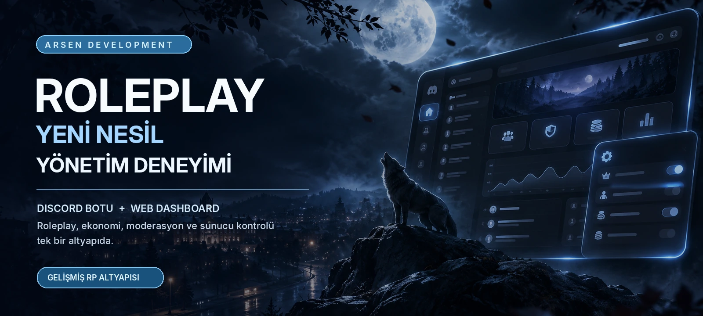
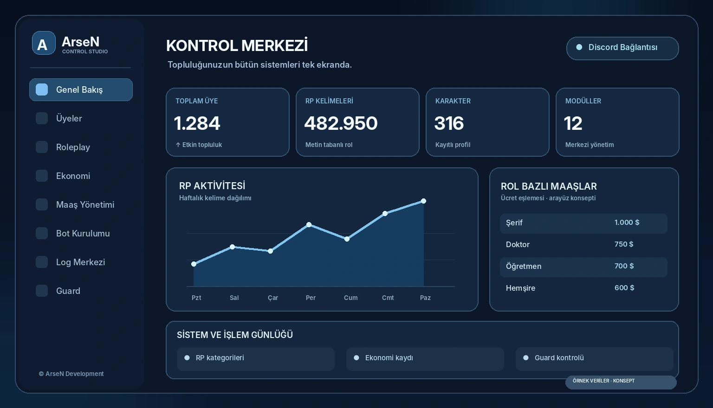

 

# ArseN Development

### WEB PANELLİ GELİŞMİŞ ROLEPLAY BOTU

**Hayal ettiğiniz evreni kurun. Yönetimi tek bir yerde toplayın.**

*Discord botu, modern web paneli ve oyuncularınıza özel karakter deneyimi.*

 

  

**450 TL / ay** &nbsp;·&nbsp; **2.500 TL tek seferlik**

---

## Bir sunucu, bir hikaye, güçlü bir altyapı.

Roleplay sunucularını özel kılan şey yalnızca kurdukları dünya değil; oyuncuların o dünyada bıraktığı izdir.

ArseN Development, karakterlerden ekonomiye, sunucu güvenliğinden yetkili yönetimine kadar günlük işleri tek bir deneyimde buluşturur. Siz hikayenize odaklanırken, sistemler arka planda düzeni korur.

 

<table>
<tr>
<td width="33%" align="center" valign="top">
<h3>◈ Tek merkez</h3>

Birden fazla bot ve dağınık ayar ekranları yerine ortak çalışan sistemler.

</td>
<td width="33%" align="center" valign="top">
<h3>✧ Oyuncuya özel</h3>

Karakter kimliği, RP ilerlemesi, ekonomi ve kişisel profil deneyimi.

</td>
<td width="33%" align="center" valign="top">
<h3>◇ Size özgü</h3>

Sunucunuzun hikayesine, rollerine ve görsel dünyasına uyarlanabilen yapı.

</td>
</tr>
</table>

---

## ◈ Kontrol merkezi, tam da elinizin altında

### Yönetmek için onlarca komutu ezberlemeniz gerekmiyor.

Bir yetkili olarak görmek istediğiniz bilgilere tek yerden ulaşın. Sunucunun gidişatını takip edin, karakterleri inceleyin, roleplay etkinliğine göz atın ve günlük yönetim işlemlerini modern bir arayüzde yürütün.

**Web paneliyle birlikte:**

- Sunucuya ait genel görünüm ve topluluk istatistikleri
- Üye ve karakter bilgilerine erişim
- Roleplay kategorileri, seviye ve ilerleme takibi
- Ekonomi kayıtları ve yetkili bakiye işlemleri
- Bot kurulumu, kanal ve rol eşlemeleri
- Güvenlik kontrolleri ve işlem geçmişi

Discord hesabınızla giriş yaparsınız. Üyeler kendilerine ait alanları, yetkililer ise görevlerine uygun yönetim bölümlerini görür.

---

## ✧ Oyuncular için de ayrı bir dünya

### Karakteriniz, ilerlemeniz ve sunucudaki yeriniz.

Bir oyuncu için roleplay yalnızca mesajlardan oluşmaz. Biriktirilen kelimeler, kazanılan seviyeler, karakterin kimliği ve sahip olduğu eşyalar da hikayenin bir parçasıdır.

Kişisel panelde karakter bilgileri, RP istatistikleri, ekonomi ve envanter gibi alanlar bir araya gelir. Telefon ekranına uyarlanan **Liquid Glass** tasarımı sayesinde bu deneyim masaüstüyle sınırlı kalmaz.

---

## ✦ Neler sunuyor?

<table>
<tr>
<td width="50%" valign="top">
<h3>🌙 Roleplay & Karakter</h3>

RP kelime sayımı, sıralamalar, seviye sistemi, seviye ödülleri, karakter kimliği ve sunucuya özel RP alanları.

</td>
<td width="50%" valign="top">
<h3>💠 Kayıt & Topluluk</h3>

Üye kayıtları, rol seçimleri, karşılama ekranları, AFK, avatar/banner, davet ve topluluk istatistikleri.

</td>
</tr>
<tr>
<td valign="top">
<h3>💰 Ekonomi & Maaşlar</h3>

Cüzdan, banka, market, envanter, para işlemleri ve meslek rollerine göre düzenlenebilen haftalık maaş sistemi.

</td>
<td valign="top">
<h3>🛡️ Moderasyon & Guard</h3>

Ban, mute, jail, uyarı ve diğer yönetim işlemleri; yetki kontrolleri, koruma sistemleri ve ayrıntılı kayıtlar.

</td>
</tr>
<tr>
<td valign="top">
<h3>🖥️ Web Yönetimi</h3>

Discord ile giriş, yetkiliye özel yönetim ekranları, karakter portalı ve mobil uyumlu kontrol merkezi.

</td>
<td valign="top">
<h3>📋 Log & Denetim</h3>

Sunucu, mesaj, moderasyon, RP ve ekonomi işlemlerini takip etmeyi kolaylaştıran kayıt ve bildirim sistemi.

</td>
</tr>
</table>

### Küçük ayrıntılar da önemli.

Butonlar, seçim menüleri, uygulamaya özel emojiler ve görsel kartlarla Discord içindeki işlemler de sunucunuzun kimliğine uyum sağlar. Yönetim ekranları yalnızca işlevsel değil, kullanması keyifli olacak şekilde tasarlanır.

---

## 💰 Her sunucunun kendine ait bir ekonomisi vardır

Bir şehir RP sunucusunun meslekleriyle fantastik bir evrenin ekonomik düzeni aynı olmak zorunda değil.

**Rol bazlı maaş sistemi**, mesleklerinize göre tutarlar belirlemenizi sağlar. Üyenin birden fazla maaşlı rolü varsa ilgili ücretler birleştirilir ve haftalık ödemesi tek seferde hesaplanır. Ekonomi, sunucunuzun kurallarına ve rol yapısına göre şekillenir.

*Doktor, öğretmen, tüccar veya evreninize özgü bambaşka bir meslek… Karar sizin.*

---

## ✨ Sizin evreniniz. Sizin kurallarınız.

Hazır bir altyapı kullanmak, herkesle aynı sunucuya sahip olmak anlamına gelmez.

Bir orta çağ krallığı, modern bir şehir, büyü akademisi, hastane veya tamamen sizin yazdığınız bir evren... **Botun görünümü ve sistemleri, kurduğunuz dünyanın ihtiyaçlarına göre şekillendirilebilir.**

<table>
<tr>
<td width="50%" valign="top">
<strong>Özgün RP sistemleri</strong> Haneler, fraksiyonlar, ırklar, meslekler, başvurular ve evrene özel ilerleme mekanikleri.
</td>
<td width="50%" valign="top">
<strong>Özel tasarım</strong> Sunucuya uygun renkler, emojiler, karakter kartları, karşılama ekranları ve web görünümü.
</td>
</tr>
<tr>
<td valign="top">
<strong>Farklı ekonomi düzenleri</strong> Meslekler, maaş tutarları, marketler, ödüller ve topluluğunuzun kurallarına uygun ekonomi akışları.
</td>
<td valign="top">
<strong>Size özel yönetim araçları</strong> Yetkili iş akışları, farklı kayıt modelleri, yeni paneller ve sunucuya özgü komutlar.
</td>
</tr>
</table>

**“Aklımdaki sistem pakette yok” demek zorunda değilsiniz.** İstediğiniz sistemi anlatın; birlikte sunucunuza uygun bir çözüm oluşturalım.

---

## 💎 Size uygun paketi seçin

<table>
<tr>
<td width="50%" align="center" valign="top">
<h3>AYLIK KULLANIM</h3>
<h2>450 TL</h2>

<strong>Her ay</strong>

Roleplay botu ve web paneliyle sunucunuzu tek merkezden yönetin.

</td>
<td width="50%" align="center" valign="top">
<h3>TEK SEFERLİK</h3>
<h2>2.500 TL</h2>

<strong>Tek ödeme</strong>

Tek seferlik satın alma seçeneğiyle aynı gelişmiş altyapıya sahip olun.

</td>
</tr>
</table>

**Her iki seçenekte de:** Discord botu · Web paneli · Roleplay · Ekonomi · Moderasyon · Guard · Loglar

**Paket kapsamında kararlaştırılan özel geliştirmeler ve VDS için ek ücret yok.**

---

## ❔ Merak edilenler

<strong>Sunucuma özel bir sistem ekletebilir miyim?</strong>

 
Evet. Kendi evreninize ait RP kuralları, karakter mekanikleri, ekonomi düzenleri veya yönetim araçları için özel geliştirme talep edebilirsiniz. İhtiyacınız olan sistemi Discord üzerinden birlikte konuşabiliriz.

<strong>Botun ve sitenin tasarımı değişebilir mi?</strong>

 
Evet. Sunucunuzun adı, teması, renkleri, görselleri ve kullanılacak özellikleri doğrultusunda tasarım özelleştirilebilir.

<strong>Web panelini telefondan kullanabilir miyim?</strong>

 
Evet. Panel, mobil cihazlar için de düzenlenmiş bir arayüze sahiptir.

<strong>Maaşlar ve ekonomi sunucuma göre ayarlanabilir mi?</strong>

 
Evet. Meslek rolleri, ücretler ve ilgili ekonomi düzeni sunucunuzun işleyişine göre yapılandırılabilir. Birden fazla maaşlı role sahip üyelerin ücretleri birlikte hesaplanır.

<strong>Hangi tür roleplay sunucuları için uygun?</strong>

 
Şehir, fantastik, akademi, hastane, tarihî ve özgün evrenlerde kullanılabilecek şekilde uyarlanabilir.

<strong>Satın almak ya da demo hakkında konuşmak için ne yapmalıyım?</strong>

 
Doğrudan <a href="https://discord.com/users/1354736569696911462">Discord üzerinden iletişime geçin</a>. Sunucu fikrinizi ve istediğiniz özellikleri konuşarak en uygun paketi belirleyebiliriz.

---

  

## Sunucunuza yakışan bir başlangıç yapın.

Kurmak istediğiniz dünyayı anlatın. Karakterler, ekonomi, yönetim ve görsel kimlik için doğru altyapıyı birlikte oluşturalım.

**450 TL / ay &nbsp;·&nbsp; 2.500 TL tek seferlik**

 

 

[**Discord üzerinden iletişime geç**](https://discord.com/users/1354736569696911462)

  

© ArseN Development · Ticari ürün tanıtımı. Yetkisiz çoğaltma ve dağıtım hakları saklıdır.

